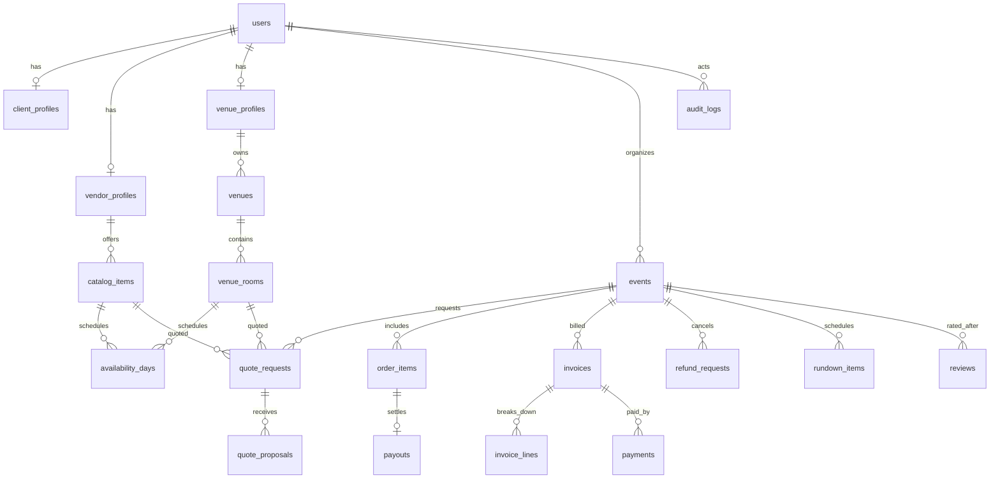

# Rancangan Database Backend — Pesta Kita

Status: **sebagian dimigrasi (per 2026-11-16)**. Skema domain non-finansial **BE-2** (16 tabel) sudah dimigrasi ke MySQL `pesta_kita` bersama **BE-1** (auth/role/profil). Tabel keuangan (`invoices`, `invoice_lines`, `payments`, `refund_requests`, `refund_transfers`, `payouts`) serta koordinasi/ulasan (`rundown_items`, `reviews`, `notifications`) **masih rancangan**, belum dimigrasi (BE-3+). Penanda status per kelompok tabel ada di bagian 4. Bukti: `php artisan migrate:status` → 23 Ran dan `docs/reports/BE-2_Implementation_Report_Pesta_Kita.md`.

> Snapshot historis 2026-11-15: belum ada migration domain, skema aktual hanya tabel bawaan Laravel, dan database MySQL `pesta_kita` belum ada. Kondisi itu sudah berubah setelah BE-1 dan BE-2 dilaksanakan; jangan membaca bagian 1 sebagai kondisi sekarang.

Jangan membuat tabel yang bergantung pada keputusan terbuka B1–B18 sebelum jawaban pengguna. Kolom yang bergantung keputusan ditandai `pending`.

## 1. Skema yang benar-benar ada

> Snapshot historis 2026-11-15 (sebelum BE-1). Sejak BE-1 + BE-2, `users` sudah punya role/phone/status dan tabel profil/domain sudah dimigrasi. Lihat bagian 4 untuk status per kelompok tabel.

| Tabel                                | Kolom penting                                                                   | Relasi domain          |
| ------------------------------------ | ------------------------------------------------------------------------------- | ---------------------- |
| `users`                              | id, name, email unique, email_verified_at, password, remember_token, timestamps | Tidak ada role         |
| `password_reset_tokens`              | email PK, token, created_at                                                     | Bawaan                 |
| `sessions`                           | id, user_id nullable index, ip, user_agent, payload, last_activity              | Bawaan                 |
| `cache`, `cache_locks`               | Bawaan                                                                          | Bukan domain           |
| `jobs`, `job_batches`, `failed_jobs` | Bawaan                                                                          | Tidak ada job aplikasi |

Model `User` mengisi `name`, `email`, `password` dan menyembunyikan `password` serta `remember_token`.

## 2. Prinsip rancangan

- Tetap satu tabel `users` dengan kolom `role`. UI daftar dan login memperlakukan satu akun sebagai satu peran: `admin`, `klien`, `vendor`, `venue`.
- Profil usaha terpisah agar data pribadi penyedia tidak ikut query katalog publik.
- Harga dan status finansial disalin ke snapshot pada saat keputusan, supaya perubahan katalog tidak mengubah tagihan lama.
- Nominal `unsignedBigInteger` dalam rupiah.
- Dokumen dan bukti memakai path disk `local`, bukan URL publik.
- Soft delete hanya untuk akun dan katalog. Transaksi keuangan tidak dihapus; statusnya berubah dan jejaknya tetap.
- Index unik untuk nomor tagihan, satu tagihan aktif per acara, dan satu pencairan hak per item.

## 3. ERD usulan

## 4. Tabel usulan

### Identitas

> Status: **dimigrasi** — BE-1 (`users` + role/phone/status, `client_profiles`, `vendor_profiles`, `venue_profiles`); BE-2 (`provider_bank_accounts`, `company_bank_accounts`).

`users` ditambah: `role` string index, `phone` nullable, `status` (`aktif`, `nonaktif`). Email tetap unique.

`client_profiles`: `user_id` unique FK. Nama tampilan cukup dari `users.name` sampai ada kebutuhan lain.

`vendor_profiles`: `user_id` unique FK, `business_name`, `category`, `address`, `pic_name`, `service_area`, `description`, `verification_status`, `verified_at`. Telepon pribadi tetap di `users.phone` dan tidak di-query untuk katalog Klien.

`venue_profiles`: pola yang sama, untuk pemilik gedung.

`provider_bank_accounts`: `owner_type`, `owner_id`, `bank_name`, `account_number`, `account_name`, `verification_status`. Nomor utuh hanya untuk Admin dan pemilik akun. Tampilan lain memakai penyamaran.

`company_bank_accounts`: `bank_name`, `account_number`, `account_name`, `is_active`. Dipilih Klien saat membayar. Dikelola Admin lewat `admin/rekening` dan `admin/rekening-form`.

### Katalog

> Status: **dimigrasi** (BE-2): `catalog_items`, `venues`, `venue_rooms`, `venue_facilities`, `media`, `price_change_requests`, `availability_days`.

`catalog_items`: milik `vendor_profiles`. Kolom: `kind` (`layanan` atau `peralatan`; B15 disetujui 2026-11-16: satu struktur katalog, tanpa tabel peralatan terpisah), `name`, `category`, `description`, `catalog_price`, `pricing_mode` (`tetap` atau `perlu_penawaran`), `max_per_day`, `status`, `policies`. Halaman terkait: `klien/katalog-vendor`, `katalog-vendor-detail`, `katalog-peralatan`, `vendor/layanan`, `vendor/item-form`, `vendor/peralatan`.

`venues`: milik `venue_profiles`. Kolom: `name`, `kind`, `capacity`, `address`, `description`, `rules`, `cancellation_policy` nullable, `rental_price`, `cleaning_fee` nullable (B4 disetujui 2026-11-16: opsional, terpisah dari harga sewa, boleh kosong; penulisan oleh Admin mengikuti bukti UI form venue), `duration_hours`, `deposit_amount` nullable (B5, ditunda), `verification_status`.

`venue_rooms`: `venue_id`, `name`, `capacity`. Kalender venue memilih ruangan. Venue dengan satu ruang tetap punya satu baris room agar kalender seragam.

`venue_facilities`: `venue_id`, `name`. Checkbox form venue.

`media`: `owner_type`, `owner_id`, `path`, `visibility` (`publik` setelah verifikasi, selain itu `privat`), `sort_order`. Profil Klien hanya membaca `publik`.

`price_change_requests`: subjek katalog atau venue, `old_price`, `new_price`, `reason`, `status`, `reviewed_by`, `reviewed_at`. Halaman `vendor/pengajuan-harga`, `venue/pengajuan-harga`, `admin/pengajuan-harga`.

`availability_days`: `subject_type` (`catalog_item` atau `venue_room`), `subject_id`, `date`, `status` (`tersedia`, `tidak_tersedia`, `belum_dikonfirmasi`), unique (`subject`, `date`). Status dipesan tidak disimpan di sini. Itu dihitung dari `order_items` yang mengikat pada tanggal yang sama (B11).

### Permintaan penawaran

> Status: **dimigrasi** (BE-2): `quote_requests`, `quote_proposals`, `quote_decisions`.

`quote_requests`: `client_id`, `event_id` nullable selama acara masih draft, `subject_type`, `subject_id`, `event_date`, `guest_count`, `budget` nullable, `notes`, `catalog_price_snapshot`, `status`.

`quote_proposals`: `quote_request_id`, `proposed_amount`, `breakdown`, `notes`, `submitted_at`. Vendor mengisi harga usulan, rincian, dan catatan. Venue mengisi harga sewa, biaya tambahan, dan catatan.

`quote_decisions`: `quote_request_id`, `admin_id`, `decision` (`disetujui` atau `ditolak`), `approved_amount` nullable, `reason`, `decided_at`. `approved_amount` hanya terisi jika disetujui.

### Acara dan pesanan

> Status: **dimigrasi** (BE-2): `events`, `order_items`, `order_objections`. Tanpa `events.venue_id` (B6); venue lewat `order_items`→`venue_room`.

`events`: `client_id`, `name`, `event_date`, `guest_count`, `theme`, `description`, `status`. Form `klien/acara-baru`: nama, tanggal, jumlah tamu, tema, deskripsi.

`order_items`: `event_id`, `provider_type`, `provider_id`, `subject_type`, `subject_id`, `quote_request_id` nullable, `catalog_price_snapshot`, `proposed_price_snapshot` nullable, `final_price` nullable sampai Admin mengunci, `status`, `rejection_reason` nullable, `objection_deadline` nullable (B7).

`order_objections`: `order_item_id`, `provider_user_id`, `reason`, `status`, `admin_decision`, `decided_at`. Halaman `vendor/keberatan`, `venue/keberatan`, `admin/keberatan`.

### Tagihan, bayar, refund, cair

> Status: **rancangan, belum dimigrasi** (BE-3+): `invoices`, `invoice_lines`, `payments`, `refund_requests`, `refund_transfers`, `payouts`.

`invoices`: `event_id`, `version`, `number` unique, `status`, `provider_subtotal`, `commission_amount`, `cleaning_fee`, `other_amount`, `unique_code` (B2), `total`, `due_at` (B9), `supersedes_invoice_id` nullable. Satu tagihan aktif per acara dijaga di aplikasi dan dengan index.

`invoice_lines`: `invoice_id`, `order_item_id` nullable, `label`, `provider_amount`, `commission_amount`, `line_total`, `line_kind` (`item`, `kebersihan`, `lainnya`, `kode_unik`).

`payments`: `invoice_id`, `company_bank_account_id`, `claimed_amount`, `proof_path`, `status`, `rejection_reason`, `reviewed_by`, `reviewed_at`. Form Klien memilih rekening dan mengunggah bukti. Admin mengesahkan atau menolak dengan alasan.

`refund_requests`: `event_id`, `invoice_id`, `reason`, `policy_snapshot` json, `status`, `approved_amount` nullable (server, B1), `rejection_reason`, `decided_by`, `decided_at`.

`refund_transfers`: `refund_request_id`, `transferred_on`, `proof_path`, `note`.

`payouts`: `payee_type`, `payee_id`, `order_item_id` nullable, `kind` (`hak_pesanan` atau `kompensasi`), `amount`, `bank_snapshot` json, `status`, `reference`, `transferred_on`, `proof_path`, `admin_note`. Unique (`order_item_id`, `kind`) ketika `order_item_id` tidak null.

### Koordinasi dan ulasan

> Status: **sebagian** — `audit_logs` dimigrasi (BE-2); `rundown_items`, `reviews`, `notifications` masih rancangan (BE-3+).

`rundown_items`: `event_id`, `owner_user_id` nullable, `title`, `starts_at`, `ends_at`, `notes`, `status`. Vendor mengubah item miliknya pada acara terkonfirmasi. Venue dan Admin hanya membaca. Tombol tambah di halaman venue tidak diberi route tulis.

`reviews`: `event_id`, `author_id`, `subject_type`, `subject_id`, `rating`, `comment`, `audience` (`agregat_penyedia` atau `internal`). Unique (`event_id`, `author_id`, `subject_type`, `subject_id`). Insert hanya jika acara selesai dan tagihan lunas.

`audit_logs`: `actor_id`, `action`, `subject_type`, `subject_id`, `from_status`, `to_status`, `reason`, `ip`, timestamps. Tidak menyimpan bukti file atau nomor rekening utuh.

`notifications`: ditunda. Halaman notifikasi ada, tetapi belum ada kanal pengiriman yang disetujui.

## 5. Kardinalitas

| Hubungan                      | Kardinalitas               | Dasar                                 |
| ----------------------------- | -------------------------- | ------------------------------------- |
| User ke profil sesuai role    | 1 ke 0..1                  | Satu peran per akun                   |
| Vendor ke item katalog        | 1 ke banyak                | Daftar layanan dan peralatan          |
| Pemilik venue ke venue        | 1 ke banyak                | Form data venue                       |
| Venue ke ruangan              | 1 ke banyak                | Kalender per ruangan                  |
| Klien ke acara                | 1 ke banyak                | Daftar acara                          |
| Acara ke item pesanan         | 1 ke banyak                | Tagihan gabungan                      |
| Acara ke tagihan              | 1 ke banyak versi, 1 aktif | Tombol buat ulang                     |
| Tagihan ke pembayaran         | 1 ke banyak percobaan      | Bukti ditolak lalu unggah ulang       |
| Item pesanan ke pencairan hak | 1 ke 0..1                  | Cegah cair ganda                      |
| Acara ke ulasan               | 1 ke banyak subjek         | Evaluasi venue, tiap vendor, internal |

Asumsi yang menunggu B6: rancangan mengizinkan lebih dari satu venue pada satu acara karena relasinya lewat `order_items`. Jika diputuskan satu venue, itu menjadi validasi aplikasi.

## 6. Index minimum

- `users.email` unique, `users.role` index.
- `catalog_items (vendor_profile_id, status, category)`.
- `venues (venue_profile_id, verification_status)`.
- `availability_days (subject_type, subject_id, date)` unique.
- `events (client_id, status, event_date)`.
- `invoices.number` unique, `invoices (event_id, version)` unique.
- `payments (invoice_id, status)`.
- `payouts (payee_type, payee_id, status)`.
- `audit_logs (subject_type, subject_id, created_at)`.

## Tambahan Tahap C dan D (2026-11-21)

### Tabel yang dipakai (sudah ada sejak Tahap A)
- `rundown_items` — `event_id`, `order_item_id` (nullable), `created_by`, `start_time`, `end_time` (nullable), `activity`, `description`. Urutan baca: `start_time`, `id`. Tidak ada kolom uang.
- `evaluations` — `event_id` unik, `system_feedback` (nullable). Satu evaluasi per acara.
- `evaluation_items` — `evaluation_id`, `target_type` (`venue`/`vendor`/`admin`), `target_id` (nullable untuk admin), `rating` 1–5, `comment` (nullable).

### Kolom baru Tahap D2 (`2026_11_21_000002_add_room_layout_to_events_table`)
| Kolom | Tipe | Nullable | Keterangan |
|---|---|---|---|
| `events.room_layout` | varchar(30) | ya | Nilai enum `RoomLayout`: `teater`, `meja_bundar`, `kelas`, `huruf_u`, `prasmanan_berdiri`, `lesehan`. |
| `events.room_layout_notes` | varchar(500) | ya | Catatan bebas susunan ruangan. |

### Media denah
- `media.kind` menerima nilai `denah` (enum `MediaKind::Denah`), pemilik `App\Models\VenueRoom`, maksimal 3 per ruangan, disk `private`, `visibility` mengikuti verifikasi penyedia seperti foto.

### Pengaturan
- `settings` kunci `budget_allocation` (JSON): `{"venue":35,"catering":30,"dekorasi":15,"hiburan":10,"peralatan":5,"cadangan":5}`. Bila belum ada, nilai bawaan dipakai. Jumlah persen divalidasi 100 pada halaman Pengaturan.
